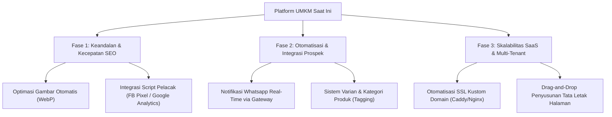

# 🚀 Rencana Pengembangan Lanjutan (Next Roadmap Plan)
## Platform Pembuat Landing Page UMKM (SaaS Ready)

Dokumen ini disusun untuk memberikan peta jalan (*roadmap*) taktis mengenai fitur-fitur premium lanjutan yang dapat ditambahkan pada platform ini untuk meningkatkan nilai jual, kestabilan, skala bisnis (SaaS), serta kemudahan operasional UMKM.

---

## 🗺️ Peta Jalan Fitur Lanjutan (Next Features Roadmap)



---

## 📁 Rincian Rencana Pengembangan Per Fase

### ⚡ Fase 1: Keandalan & Kecepatan SEO (Visual & Performance)
Karena target utama platform ini adalah UMKM yang sering kali mengunggah gambar beresolusi tinggi langsung dari HP tanpa kompresi, fase ini sangat krusial untuk menjaga performa loading page tetap di bawah 1.5 detik (Syarat utama SEO bagus).

1. **Optimasi Gambar Otomatis (WebP Converter)**:
   * **Masalah saat ini**: UMKM mengunggah gambar `.jpg` atau `.png` berukuran 5MB+ yang memperlambat landing page.
   * **Solusi**: Pasang modul `sharp` di backend NestJS. Setiap kali gambar diunggah ke `UploadController`, backend otomatis mengompresi gambar, mengubah dimensinya ke resolusi optimal, dan mengonversinya ke format generasi baru `.webp` (ukuran berkurang hingga 80% tanpa kehilangan ketajaman).

2. **Integrasi Script Pelacak Kustom (FB Pixel, TikTok Pixel & Google Tag Manager)**:
   * **Penjelasan**: Berikan form input di dasbor **SEO & Pemasaran** bagi Owner untuk memasukkan Pixel ID mereka.
   * **Teknis**: Di `PublicSite.jsx`, suntikkan kode pelacak secara dinamis di bagian `<head>` berdasarkan ID pixel yang tersimpan di database. Ini sangat dicari oleh UMKM yang aktif beriklan digital (*digital marketing*).

---

### 🤖 Fase 2: Otomatisasi & Integrasi Prospek (Automation & Conversion)
Mengubah landing page pasif menjadi alat penjualan yang sangat proaktif dan otomatis.

1. **Notifikasi WhatsApp/Telegram Prospek Baru (Real-time Notification)**:
   * **Penjelasan**: Saat pengunjung mengirim formulir kontak/leads di landing page, sistem tidak hanya menyimpan ke database, tetapi langsung mengirimkan notifikasi ringkasan ke nomor WhatsApp atau Telegram milik Owner UMKM.
   * **Teknis**: Hubungkan dengan WhatsApp Gateway API (seperti Fonnte/Waba) atau Telegram Bot API di backend NestJS saat event `Leads.create` terpicu.

2. **Sistem Varian & Kategori Katalog Produk**:
   * **Penjelasan**: Izinkan Owner mengelompokkan produk berdasarkan Kategori (misal: *Makanan*, *Minuman*, *Merchandise*) dan menambahkan opsi varian (misal: *Ukuran: M/L*, *Level Pedas: 1-5*).
   * **Teknis**: Perbarui model `Product` di Prisma untuk berelasi dengan `Category` dan tambahkan JSON field untuk menyimpan opsi varian.

---

### 🌐 Fase 3: Skalabilitas SaaS & Multi-Tenant (Enterprise Readiness)
Menyiapkan platform agar siap dikomersialkan menjadi layanan SaaS berlangganan bulanan di mana ribuan UMKM bisa mendaftar mandiri.

1. **Otomatisasi Sistem SSL Kustom Domain**:
   * **Penjelasan**: Saat ini Owner bisa memasukkan domain kustom mereka (misal: `tokokopi.com`). Namun, penyediaan sertifikat SSL (HTTPS) masih manual.
   * **Solusi**: Integrasikan platform dengan **Caddy Server** atau **Nginx Proxy Manager API**. Caddy memiliki fitur *On-Demand TLS* yang secara otomatis menerbitkan dan memperbarui sertifikat SSL Let's Encrypt secara gratis saat domain kustom UMKM pertama kali diakses.

2. **Drag-and-Drop Tata Letak Seksi Halaman (Section Re-ordering)**:
   * **Penjelasan**: Berikan fleksibilitas bagi Owner untuk menyusun ulang tata letak seksi di landing page mereka (misal: ingin menaruh Galeri Foto di atas Katalog Produk).
   * **Teknis**: Tambahkan kolom `order` (integer) pada tabel `CustomSection` dan seksi-seksi default lainnya. Di frontend, gunakan library seperti `@hello-pangea/dnd` untuk antarmuka seret-dan-lepas yang mulus di dasbor admin.

---

## 🛠️ Langkah Teknis Awal yang Direkomendasikan (First Action Items)

Jika Anda ingin mulai mencicil dari yang paling mudah dan berimbas besar, berikut adalah 3 langkah prioritas pertama:

1. **Instalasi Sharp untuk Kompresi Gambar** (Backend):
   ```bash
   npm install sharp @types/multer
   ```
   Lalu buat interceptor multer di backend untuk memproses kompresi WebP sebelum gambar disimpan.

2. **Pembuatan Kategori Produk** (Fullstack):
   * Tambahkan model `Category` di `schema.prisma`.
   * Perbarui form tambah produk untuk menampilkan dropdown kategori.

3. **Integrasi Script Tracking** (Frontend):
   * Tambahkan kolom `facebookPixelId` dan `googleAnalyticsId` di skema SEO.
   * Gunakan helper di `PublicSite.jsx` untuk menambahkan script pelacak ke DOM.

---

> **Tip Keamanan Port 3000**:
> Jika Anda mengalami kendala port 3000 masih terkunci saat menjalankan server NestJS secara manual, saya dapat membantu menghentikan proses latar belakang secara aman. Cukup katakan *"Matikan server latar belakang"*!
