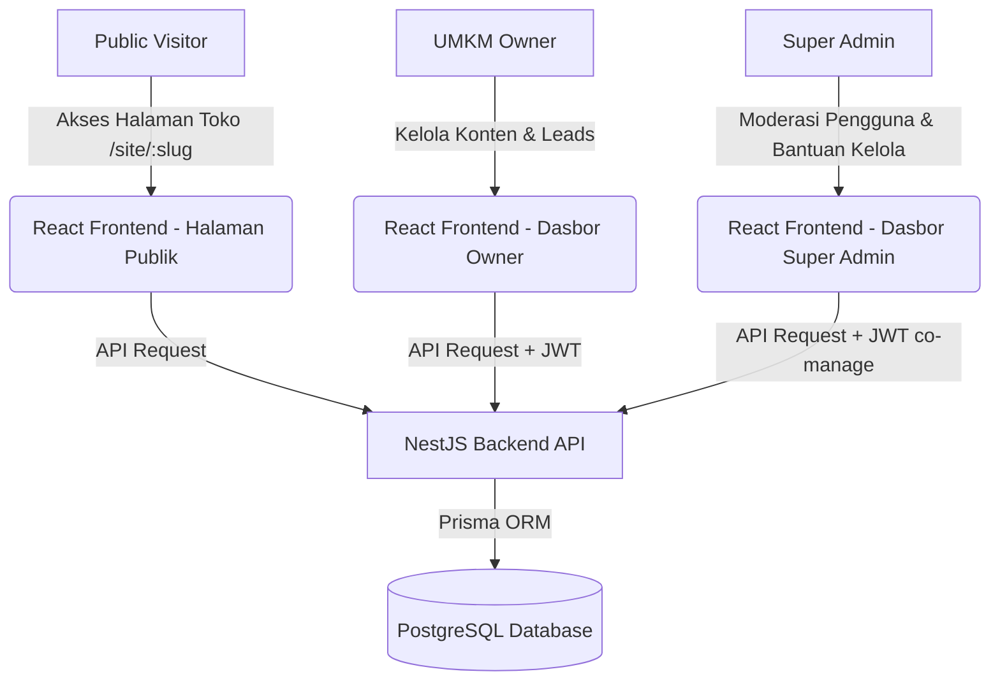

# Dokumentasi Sistem: UMKM Landing Builder SaaS Platform

Selamat datang di **Dokumentasi Lengkap UMKM Landing Builder SaaS Platform**. Dokumentasi ini menyediakan panduan menyeluruh mengenai arsitektur sistem, struktur database, alur keamanan, fitur premium, hingga langkah-langkah instalasi dan pengujian aplikasi.

Aplikasi ini dirancang sebagai platform **Software as a Service (SaaS)** multi-tenant yang memungkinkan para pemilik usaha (UMKM) membuat, mendesain, dan mengelola halaman landing page toko mereka secara instan dengan desain modern, cepat, serta berestetika tinggi.

---

## 1. Ringkasan & Arsitektur Teknologi

Sistem ini dikembangkan menggunakan tumpukan teknologi modern berkinerja tinggi (*high-performance tech stack*):

*   **Frontend**: React.js (Vite), Tailwind CSS untuk styling premium, Lucide React untuk ikonografi, dan Fetch API untuk integrasi asinkron dengan REST API.
*   **Backend**: NestJS (TypeScript) dengan arsitektur modular terstruktur, dilengkapi `class-validator` untuk validasi DTO, JWT Strategy untuk otentikasi aman, dan `@Roles` Guard untuk otorisasi akses.
*   **Database & ORM**: PostgreSQL sebagai database relasional utama, diintegrasikan melalui Prisma ORM dengan skema relasi yang kuat dan fitur penghapusan kaskade (*cascade delete*).
*   **Containerization**: Docker Compose untuk kemudahan instalasi database PostgreSQL di lingkungan lokal (*local development*).



---

## 2. Struktur Database (Skema Prisma)

Skema database diimplementasikan menggunakan relasi terstruktur untuk mendukung pembatasan data antar penyewa (*tenant boundaries*). Berikut adalah entitas utama yang didefinisikan dalam `schema.prisma`:

*   **User**: Menyimpan data akun pengguna dengan peran `OWNER` atau `SUPER_ADMIN`. Akun dapat diblokir (`isBanned`) atau dihapus oleh Super Admin.
*   **LandingPage**: Hub sentral untuk setiap UMKM. Menyimpan konfigurasi tema warna (`themeColor`), persetujuan bantuan admin (`allowAdminEdit`), domain kustom, serta statistik kunjungan akumulatif (`views`).
*   **Business**: Menyimpan informasi kontak utama bisnis seperti nama, kategori, nomor WhatsApp, email, alamat lengkap, jam buka operasional, link media sosial, serta tautan peta Google Maps.
*   **HeroSection & AboutSection**: Menyimpan konten visual utama untuk landing page publik (judul, deskripsi, gambar, dan tombol ajakan bertindak / CTA).
*   **Product**: Katalog produk/layanan milik UMKM, lengkap dengan nama, deskripsi, harga, gambar, dan tautan pembelian langsung.
*   **GalleryItem**: Foto dokumentasi atau portofolio kegiatan operasional bisnis UMKM.
*   **Testimonial**: Ulasan terverifikasi dari pelanggan untuk membangun kepercayaan pengunjung (*social proof*).
*   **Lead**: Data prospek atau pesan pelanggan yang dikirim melalui formulir kontak di landing page publik.
*   **SeoSetting**: Pengaturan metadata SEO (Meta Title, Description, Keywords) untuk optimasi mesin pencari secara dinamis.

---

## 3. Fitur Utama & Premium ("Semua Opsi Di Atas")

Sistem ini dilengkapi dengan berbagai fitur premium bernilai tinggi untuk memastikan pengalaman pengguna yang luar biasa (*wow factor*):

### 3.1. Mode Terang & Gelap Dinamis (Light & Dark Modes)
*   Halaman publik dilengkapi dengan tombol sakelar (*floating glassmorphic toggle*) bergambar Matahari/Bulan.
*   Peralihan mode didukung efek transisi warna halus (`transition-colors duration-500`) yang secara instan merombak latar belakang, teks, batas elemen, kolom input formulir, hingga filter visual peta lokasi.

### 3.2. Presets Warna & Custom Hex Color Picker
*   **8 Preset Warna**: Menyediakan 8 preset tema warna harmonis berbasis HSL (**Emerald Green, Ocean Blue, Coffee Amber, Indigo Purple, Rose Pink, Teal Cyan, Sunset Orange, Fuchsia Magenta**).
*   **Custom Color Picker**: Fitur input warna kustom yang memungkinkan pemilik toko memasukkan kode Hex apa saja (misalnya `#FF5500`). Warna ini diinjeksikan sebagai variabel CSS dinamis `--brand-primary` ke seluruh elemen interaktif, tombol, ornamen, dan widget melayang WhatsApp di landing page.

### 3.3. Sistem Bantuan Kelola Admin Aman (Co-Management Consent)
*   **Kontrol Consent Penuh**: Di dasbor Owner terdapat tombol sakelar **"Izin Akses Bantuan Administrator"** yang memodifikasi status `allowAdminEdit` di database. Izin dapat diaktifkan dan dicabut kapan saja secara instan.
*   **Visual Super Admin**: Dasbor admin menampilkan status izin tiap UMKM secara langsung. Tombol hijau **"Bantu Kelola"** hanya muncul jika izin aktif, sementara UMKM dengan izin tidak aktif ditandai dengan ikon gembok **"Terkunci"**.
*   **Keamanan Scoped API**: Jika Super Admin meluncurkan sesi bantuan kelola, frontend mengirimkan parameter query `?landingPageId=...` secara transparan. Backend NestJS melakukan verifikasi ketat: jika izin `allowAdminEdit` di database bernilai `false`, sistem langsung menolak request dengan status `403 ForbiddenException`.
*   **Sesi Bantuan Interaktif**: Dilengkapi dengan bilah amber persisten (*Session Banner*) di bagian atas layar untuk mempermudah navigasi admin keluar-masuk dari mode kelola.

### 3.4. Smooth-Scroll dengan Offset Header
*   Navigasi menu utama di halaman publik menggunakan efek *smooth scrolling* bawaan React dengan offset **80 piksel**.
*   Offset ini memastikan posisi judul seksi target tidak tertutup oleh bilah navigasi melayang (*sticky glassmorphic navbar*).

### 3.5. Detail Produk Lightbox Modal
*   Menampilkan detail informasi produk secara interaktif dalam bentuk modal pop-up dengan latar belakang buram transparan (*glassmorphic popup*).
*   Menyediakan tombol pemesanan langsung yang otomatis membuat tautan khusus untuk memulai obrolan WhatsApp dengan pesan teks terisi otomatis sesuai nama produk terkait.

### 3.6. Peta Google Maps Dinamis & Ekspor CSV Prospek
*   **Inversi Peta Otomatis**: Integrasi iframe peta Google Maps yang secara otomatis terinversi menjadi warna gelap estetis pada mode malam menggunakan properti CSS filter (`invert(90%) hue-rotate(180deg)`).
*   **Ekspor Data Prospek**: Fitur unduhan data kontak leads ke format `.csv` dengan penambahan *BOM (Byte Order Mark)* UTF-8 untuk menjamin kompatibilitas dan menghilangkan error pembacaan karakter pada Microsoft Excel.

### 3.7. Unggah Gambar Secara Aman (Secure File Uploads)
*   **NestJS Multer Engine**: Mendukung penyimpanan file gambar secara langsung di sisi server backend (`/uploads/`) dengan pembatasan ukuran file maksimal 5MB serta filter tipe file khusus (JPG, PNG, WebP, GIF).
*   **Komponen Uploader Interaktif**: Dilengkapi drag-and-drop uploader di frontend (`ImageUploader.jsx`) dengan visual dropzone modern, deteksi file, animasi progress bar, serta opsi fallback input URL.
*   **Integrasi Penuh**: Diterapkan secara merata di seluruh komponen yang membutuhkan aset gambar (Banner Hero, Tentang Kami, Katalog Produk, Galeri Foto, Testimoni Pelanggan, dan Logo Profil Toko).

### 3.8. Slide Carousel & Kustomisasi Baris Katalog (Snap Carousel Slider)
*   **Horizontal Snap Scroll**: Menampilkan Katalog Produk, Galeri, dan Testimoni dalam bentuk slider horizontal premium berbasis CSS snap-scroll. Slider dilengkapi tombol panah kiri-kanan serta indikator scrollbar baris tipis yang estetik.
*   **Kustomisasi Baris (Layout Multi-row)**: Pemilik toko dapat mengatur tampilan slider dalam **1, 2, atau 3 baris** secara visual di editor dasbor. Produk/galeri/testimoni akan otomatis mengalir dan bertumpuk secara horizontal sesuai konfigurasi baris, meminimalisir penumpukan elemen ke bawah halaman.

### 3.9. Navigasi Kustom & Pemuatan Awal Cerdas (Custom Nav Builder)
*   **Editor Visual Navigasi**: Menu navigasi publik kini dapat dikustomisasi sesuka hati (ganti nama menu, ubah tipe tautan internal/eksternal, hapus menu, atau tambah tautan URL baru).
*   **Smart Template Preloading**: Ketika pemilik toko mulai mengustomisasi navigasi kustom untuk pertama kalinya, sistem secara cerdas **memuat awal 6 menu default** (Home, Tentang Kami, Produk, Galeri, Testimoni, Kontak) sebagai template awal agar pemilik tidak kehilangan menu dasar.
*   **Penyetelan Ulang Terintegrasi**: Menyediakan tombol **"Reset ke Default"** yang mengirimkan reset payload `[]` ke database untuk kembali mengaktifkan navigasi dinamis bawaan sistem secara otomatis.
*   **Tips Panduan ID Bagian**: Editor dilengkapi daftar ID resmi bagian halaman (`home`, `about`, `products`, etc.) sebagai panduan untuk mempermudah pemasangan link anchor.

### 3.10. Mode Terang & Gelap di Panel Admin (Admin Theme Context)
*   **Persistent Theme**: Panel dashboard admin kini mendukung penuh mode terang (*Light Mode*) dan mode gelap (*Dark Mode*) yang persisten disimpan di penyimpanan lokal browser (*Local Storage*).
*   **Tailwind Dark Selectors**: Seluruh tata letak dasbor admin, sidebar kaca, form input, modal, dan tabel telah ditambahkan selektor `dark:...` yang mulus dan nyaman di mata saat dialihkan.

---

## 4. Struktur Direktori Proyek

Aplikasi ini dibagi menjadi dua bagian terpisah untuk mempermudah pengembangan dan skalabilitas:

```
umkm-landing-page/
├── backend/                  # NestJS API Service
│   ├── prisma/
│   │   ├── schema.prisma     # Definisi Skema database
│   │   └── seed.ts           # Seeder untuk data demo default
│   ├── src/
│   │   ├── auth/             # Modul Register, Login, & Guards
│   │   ├── users/            # Modul Moderasi User oleh Admin
│   │   ├── business/         # CRUD Profil Bisnis UMKM
│   │   ├── landing-page/     # Pengaturan tata letak & slug publik
│   │   ├── products/         # CRUD Katalog Produk
│   │   ├── gallery/          # CRUD Galeri Dokumentasi Foto
│   │   ├── testimonials/     # CRUD Ulasan Pelanggan
│   │   ├── leads/            # Submit & Kelola Pesan Pelanggan
│   │   ├── seo/              # Konfigurasi SEO Meta Tags
│   │   ├── domain/           # Simulasi Integrasi Domain Kustom
│   │   ├── analytics/        # Kalkulasi Konversi & Grafik views
│   │   ├── prisma.service.ts # Instansiasi Database Connection
│   │   ├── app.module.ts     # Pemasangan modul global
│   │   └── main.ts           # Bootstrap backend server (CORS, Pipes)
│   └── .env                  # Konfigurasi port, DB, & JWT Secret
└── frontend/                 # React (Vite) Web Application
    ├── src/
    │   ├── components/       # Komponen UI Reusable
    │   ├── context/
    │   │   └── AuthContext.jsx # Manajemen Token & Session Login
    │   ├── layouts/
    │   │   └── DashboardLayout.jsx # Struktur dasbor kaca modern
    │   ├── pages/
    │   │   ├── admin/
    │   │   │   ├── Overview.jsx         # Dasbor utama statistik & charts
    │   │   │   ├── Profile.jsx          # Edit info kontak & Google Maps
    │   │   │   ├── LandingPageEditor.jsx # Konten Hero, About & Tema Warna
    │   │   │   ├── ProductsManager.jsx  # Kelola katalog menu produk
    │   │   │   ├── GalleryManager.jsx   # Upload foto kegiatan
    │   │   │   ├── TestimonialsManager.jsx # Kelola review terverifikasi
    │   │   │   ├── LeadsManager.jsx     # Tabel pesan prospek & Ekspor CSV
    │   │   │   ├── SeoSettings.jsx      # Input metadata SEO Google
    │   │   │   ├── DomainSettings.jsx   # Pengaturan domain kustom
    │   │   │   └── SuperAdminDashboard.jsx # Panel moderasi & Bantu Kelola
    │   │   ├── Login.jsx
    │   │   ├── Register.jsx
    │   │   └── PublicSite.jsx  # Halaman Landing Page Publik UMKM
    │   ├── services/
    │   │   └── api.js          # Pengelola HTTP Fetch Requests
    │   ├── App.jsx            # Router halaman & Proteksi Role
    │   └── index.css          # Kumpulan CSS Premium & Token Utama
    └── tailwind.config.js     # Konfigurasi kustom tema Tailwind
```

---

## 5. Cara Menjalankan Aplikasi Secara Lokal

Ikuti langkah-langkah berikut untuk mengaktifkan dan menguji sistem secara lokal di perangkat Anda:

### Prasyarat Utama
Pastikan perangkat Anda sudah terinstal:
*   [Node.js](https://nodejs.org/) (versi LTS direkomendasikan)
*   [Docker Desktop](https://www.docker.com/products/docker-desktop/) (untuk database)

---

### Langkah 1: Jalankan Database PostgreSQL
Buka terminal baru di direktori utama `umkm-landing-page` dan jalankan perintah:
```bash
docker-compose up -d
```
*Catatan: Database dikonfigurasi untuk berjalan pada port kustom **5433** guna menghindari konflik dengan instalasi PostgreSQL lokal bawaan di port 5432.*

---

### Langkah 2: Inisialisasi Database Backend
Masuk ke dalam direktori `/backend`:
```bash
cd backend
```

1. Pasang seluruh pustaka dependensi backend:
   ```bash
   npm install
   ```

2. Jalankan migrasi Prisma untuk membuat tabel database otomatis:
   ```bash
   npx prisma db push
   ```

3. Jalankan skrip seeder untuk mengisi data demo secara otomatis:
   ```bash
   npx prisma db seed
   ```

---

### Langkah 3: Jalankan Backend API Server
Di dalam direktori `/backend`, jalankan server pengembangan NestJS:
```bash
npm run start:dev
```
Server backend akan berjalan di alamat **`http://localhost:3000`**. Anda dapat mengakses Swagger dokumentasi API (jika terpasang) atau menguji konektivitas REST API.

---

### Langkah 4: Jalankan Frontend Web Application
Buka terminal baru yang terpisah, lalu masuk ke direktori `/frontend`:
```bash
cd frontend
```

1. Pasang dependensi aplikasi frontend:
   ```bash
   npm install
   ```

2. Jalankan server pengembangan Vite:
   ```bash
   npm run dev
   ```
Server frontend akan berjalan di alamat **`http://localhost:5173`**.

---

## 6. Skenario Pengetesan & Akun Demo

Untuk memudahkan proses evaluasi dan pengujian sistem, gunakan kredensial demo bawaan berikut yang telah disiapkan secara otomatis oleh skrip seeder database:

### 1. Akun Pemilik Toko (UMKM Owner - Kopi Senja)
*   **Email**: `owner@kopisenja.com`
*   **Password**: `owner123`
*   **Peran (Role)**: `OWNER`
*   **Akses Fitur**: Pemilik dapat mengedit profil Kopi Senja, mengunggah foto produk, melihat pesan prospek masuk, mengunduh laporan CSV, mengubah tema warna, serta mengatur izin bantuan kelola admin (`allowAdminEdit`).

### 2. Akun Super Administrator
*   **Email**: `superadmin@umkm.com`
*   **Password**: `admin123`
*   **Peran (Role)**: `SUPER_ADMIN`
*   **Akses Fitur**: Memoderasi pengguna (memblokir/mengaktifkan akun owner), menghapus halaman landing page, melihat daftar UMKM terdaftar, dan melakukan sesi **Bantu Kelola** khusus untuk UMKM yang memberikan izin akses aktif.

### 3. URL Halaman Landing Publik
Pengunjung umum dapat langsung melihat landing page terpublikasi dari Kopi Senja secara dinamis pada alamat berikut:
*   **Alamat URL**: **`http://localhost:5173/site/kopi-senja`**
*   **Fitur Pengunjung**: Memilih tema gelap/terang, mengirimkan pesan formulir prospek, melihat detail katalog produk via modal, melakukan simulasi pemesanan WhatsApp, dan melihat lokasi via Google Maps.

---

## 7. Penjelasan Keamanan Role-Based Access Control (RBAC)

Aplikasi menerapkan sistem otorisasi berlapis untuk mencegah manipulasi data tidak sah antar tenant (*Cross-Tenant Data Tampering*):

1.  **Auth Guard (JWT)**: Setiap request ke API terlindung (kecuali endpoint publik `/landing-page/slug/:slug` dan `/leads/submit`) wajib menyertakan Authorization Header berupa `Bearer <JWT_TOKEN>`.
2.  **Roles Guard**: Mengatur pembatasan akses endpoint berdasarkan peran pengguna. Contoh: Endpoint di bawah `users.controller.ts` hanya bisa dieksekusi oleh pengguna berstatus `SUPER_ADMIN`.
3.  **Tenant Isolation (Prisma)**: Pada service NestJS (misal `products.service.ts`), data produk disaring berdasarkan pemilik token yang terotentikasi. Seorang Owner tidak akan pernah bisa mengakses atau mengubah produk milik toko lain karena kueri Prisma selalu menyertakan filter `where: { landingPage: { userId } }`.
4.  **Admin Impersonation Security**: Ketika admin melakukan bantuan kelola (`?landingPageId=...`), kueri database secara implisit memverifikasi status izin:
    ```typescript
    const page = await this.prisma.landingPage.findUnique({ where: { id: landingPageId } });
    if (!page.allowAdminEdit && userRole !== 'OWNER') {
      throw new ForbiddenException('Akses ditolak. Pemilik belum memberikan izin bantuan.');
    }
    ```
    Hal ini memastikan data pemilik tetap aman meskipun ada percobaan akses tidak sah secara manual.
